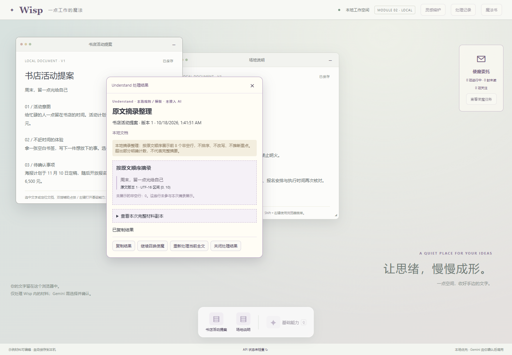

2026-10-18 集成完成：三个本地分支已合入 main，多材料动画和导入互斥已补齐；248 项前端单元、83 项 API、159 项既有浏览器＋4 项新增交叉回归、类型与构建通过。下方各分支测试数量保留为历史记录；当前集成结果见 [合并验证](docs/merge-integration-verification.md)。

> **队友便携包：先阅读 [START-HERE.txt](START-HERE.txt)，双击 Start-Wisp.cmd，使用 http://127.0.0.1:15278/ 。包内已带运行环境和服务端 Gemini 配置。下面的开发环境安装步骤可跳过。**

> 本文的 Canvas 白板和复杂格式导入说明对应当前源码。既有便携 ZIP 尚未为 PDF-01／02 更新重新打包。

# Wisp · 光标旁的小魔女

PDF-05 分支新增熔炉多材料处理：点击“勾选多材料”，选择 2～12 份后进入三能力或 Summon 确认；逐份核对全文／选段、来源和版本，合计最多 60,000 UTF-16 单元。明确提交后一次 Gemini 综合处理，前台保存一条处理记录，使魔保存一条任务回信；单材料与本地规则继续保留。当前主 15278 预览尚未集成此分支，范围及错误规则见 [多材料契约](contracts/multi-material.md)。

本分支已通过 184 项前端单元、77 项 API、46 项浏览器及类型／构建检查；模型响应为模拟，真实输出与用户体验待审阅。见 [PDF-05 验证记录](docs/pdf05-multi-material-verification.md)。

Wisp 是一个在浏览器里运行的文字工作台。你可以编辑材料，让小魔女整理原文、检查疑点、生成模板，也可以把一次任务交给使魔。

**最简单的路径：选中文字或定位一份文档 → 双指辅助点按 / 鼠标右键 → 选择基础能力 → 确认材料 → 在小浮层里查看、复制、关闭，或继续召唤使魔。**

这是本机原型，不会读取其他软件；上传代码到 GitHub 也不会自动让它成为在线网站。



## 魔杖指针与魔女基础动作（2026-10-18）

普通工作区现在使用深紫／金星魔杖光标，尖端对应点击位置；魔女跟随并在停留约半秒后轻浮。编辑文字、拖选或拖动窗口时，魔女暂时停靠右下角；结束操作后恢复跟随，文字输入保持聚焦期间继续让位。文字、窗口拖动／缩放和禁用控件使用语义清楚的原生光标图像，加载失败时回退到对应系统指针。

首批四项魔杖反馈现已实现：悬停可点元素时杖尖亮起；按下时聚光，实际点击后出现约 160ms 的短光效；在正在处理的浮层／熔炉区域显示双星忙碌提示；拖动窗口时显示抓住光标与牵引环，松开或取消即恢复。拖出控件取消按下不会产生点击光效；光效不阻挡原操作。普通、悬停和按下光标均为 24×24，使用相同尖端热点。

第二批四种常用指针已统一为紫金风格：标题栏悬停是四向牵引标记，文本区是带小星的 I 形，右下缩放点是双向斜箭头，不可用控件是暗魔杖加圈斜杠。均为 24px；前三者按中心定位，禁止沿用杖尖定位。原生选字、复制与输入继续可用；标题栏按钮仍显示可点击反馈，实际拖动沿用现有抓取中光标与牵引环。素材对照及验证见 [WP-05 记录](docs/wp05-semantic-cursors-verification.md)。

三种操作结果反馈现已接入：真实处理／保存／复制成功后亮起星芒，失败出现感叹号，明确取消准备或真正停止等待后光点收回，约 720ms 后恢复。新操作清掉旧提示，迟到结果不覆盖新提示或复制文案；正常关闭已完成结果不播放取消。停止时若结果已进入保存，则按实际保存结局显示，后台使魔回信不改变当前指针。减少动态时使用同形静态提示，现有结果／错误文字保留。详见 [WP-06 验证](docs/wp06-outcome-feedback-verification.md)。

忙碌提示只跟随指针所在的相关区域，后台使魔任务不会让整个工作区进入等待状态。“停止等待”、仍可用的按钮和原文编辑保留各自反馈；文本 I 型、缩放方向箭头和禁用标记优先。

魔女会随鼠标左右转身，上移时保持轻微抬升，下移时明显俯冲（纯下约 60°，45° 斜下约 30°）；旋转后会留出边缘空间，停止后保留朝向，细微抖动不会反复翻转。右键／触控板辅助点按、非输入状态 Q 或底部“基础能力”呼出菜单时，同一只魔女切换为举杖姿势，杖尖亮起并带出约 250ms 的光痕与法阵。菜单固定在本次点击附近，边缘向内避让；动画中也可立即选择、Esc 或点环外取消。普通左键保持原操作。

魔法书 Settings 的“减少动态效果”或系统减少动态偏好会让魔女固定停靠，呼出时直接显示静态举杖与菜单；魔杖保留静态悬停、按下和双星忙碌标记，停止点击光效与旋转动画。隐藏角色后，菜单和魔杖反馈仍可用。阅读／巡检／构思／熔炉／召唤表现见下方本分支扩展；减少动态时任务改为静态姿势。检查记录见 [WP-04 魔杖反馈验证](docs/wp04-wand-feedback-verification.md)、[WP-03／03A 验证](docs/wp03-direction-casting-verification.md)，基础规则历史见 [WP-02 验证](docs/wp02-wand-companion-verification.md)。

## 角色表现扩展（PDF-07～10，本分支已实现）

魔法书 Settings 增加“待机节奏”：默认／活泼。停留半秒后轻浮保持，小动作分别在约 1.2 秒／0.65 秒后开始，依次整理帽子、扫星屑、打盹，移动会打断。节奏保存在本机；旧设置自动采用默认。

本轮已实现：使魔真实入库后从召唤位置飞向右侧任务标记；普通 Understand 阅读、Check 举杖扫描、Create 读书构思，从当前熔炉启动三能力显示熬制气泡，多材料新面板在跨分支集成时显式接入。动作服从真实处理中与成功／失败／取消，不延迟结果；菜单及编辑让位优先，前台处理优先于最新后台任务。减少动态时静态显示，隐藏角色仍可操作。多材料处理面板显式接入熬制，导入文件和保存材料不播放熬制。

164 项单元、58 项浏览器、类型与构建通过，用户观感及集成待审阅；现有 15278 预览与便携 ZIP 未更新。窄屏无安全位置时隐藏装饰，召唤交接到魔法书。见 [验证与接线契约](docs/pdf0710-character-verification.md)。完整确认见根目录 DESIGN.md 第 4.13 节。

## 先分清基础能力的四个入口

| 入口 | 现在能做什么 | 需要 Gemini 吗？ |
| --- | --- | --- |
| Understand | 本地摘录前 3 或 8 个非空行；Gemini 生成带依据的摘要与要点 | 可选 |
| Check | 本地检查有限的日期句式；也可选择 Gemini 检查疑点与缺失信息 | 可选 |
| Create | 本地填写活动介绍模板；Gemini 生成草稿，分别列出依据、假设和待补充项 | 可选 |
| Summon | 选择三种使魔处理一次任务，完成后查看回信 | 三种使魔均可选 |

上表的基础能力和使魔操作默认本地；切换使魔也回到本地。只有明确选择 Gemini 并点击运行或召唤才发送请求。Canvas 的“寻找联系”单独使用 Gemini，流程见下节。

使魔分工：Scout Bat 巡读蝠负责 Check，Page Sprite 书页灵负责 Understand，Alchemy Imp 炼金灵负责 Create。结果不会自动覆盖你的原文。

## Canvas 白板与连线（PDF-01，2026-10-18）

1. 点击底部程序坞 **Canvas**，新建纯文本便笺，填写标题与正文后点“保存便笺”。可编辑、拖动便笺，或聚焦移动按钮后用方向键移动。
2. 用 **Shift 点选两张**便笺，或勾选两张便笺；侧栏展示本次选择。每次只分析两张非空便笺，正文合计最多 60,000 个 UTF-16 单元。
3. 开启魔法书 Settings → Helpful proposals 后，选定两张并短暂停留会出现寻找联系的邀请；“暂时不用”不调用模型。关闭主动提议时，仍可使用手动“寻找联系”按钮。
4. 点击“寻找联系”才把这两张便笺的标题和全文副本提交给 **Gemini**。返回至多一条候选，用虚线展示，附关系说明和两端原文依据；没有联系或请求失败会明确提示，不自动重试。
5. 点击“保留关系”后才将关系及分析时的文字版本保存到当前浏览器，连线变实线；刷新可恢复便笺、位置和已保留关系。保存失败可再次保留已有候选，不重新请求模型。
6. 修改便笺标题或正文后，未保留的旧候选失效，已保留关系标为“待复核”并保留旧依据；只移动位置不使关系失效。移除便笺前会确认，并一并移除关联连线；单独移除连线会保留两张便笺。

关系仅依据本次两张便笺提出，引用匹配不保证语义判断正确，是否保留由你决定。本轮功能验证使用模拟模型响应；Canvas 的真实 Gemini 调用与用户观感尚未验收。

## PDF-03／04 真实 Gemini 运行入口（2026-10-18）

拖入或保存冻结副本后，选择材料的 Understand／Check／Create，在确认面板把“执行方式”切换为 Gemini，再点击运行。原文来源、版本和选区范围随结果保留；导入本身仍在本机完成。

隔离副本可以直接读取已有服务端配置，默认仍读取当前 Wisp/.env；无需复制密钥：

```powershell
runtime\python\python.exe -I -B launch.py --port 15311 --config "C:\path\to\Wisp\.env"
```

`--no-browser` 可只启动服务。配置留在服务端，页面不接收密钥。15311 与主预览 15278 独立，浏览器材料按网址分别保存。真实调用仍以服务实际响应为准，接线与网络验证状态见 [验证记录](docs/pdf03-04-import-copies-verification.md)。

## 拖放与文档副本（PDF-03／04，本分支已验证，待集成）

- 将单个 TXT／DOCX／PPTX／XLSX／PDF 拖入页面或熔炉，读取后核对可编辑预览，点击“确认加入”保存。也可继续使用“导入文件”。
- 桌面标题栏“入炉”是独立把手：拖向顶部“灵感熔炉”，或直接点击。原标题栏仍用于移动窗口。
- 文档下方“全文副本入炉”“选区副本入炉”，或熔炉“当前文档全文副本”“当前选区副本”，冻结相应范围。预览展示原标题、版本及范围，确认保存后得到独立材料；原文后续变化不会改变副本。
- 原文尚未保存或有冲突时先完成保存；已有导入草稿、处理中、其他面板或容量已满时拒绝新拖入。冲突不覆盖草稿；取消新增、备份未保存正文并重新载入页面后获取；普通存储失败保留预览，可重试。

## 文件导入（PDF-02，2026-10-18）

1. 打开顶栏 **灵感熔炉 → 导入文件**，选择一份 TXT、DOCX、PPTX、XLSX 或 PDF。
2. 等待本机提取文字，核对解析提示、页码／幻灯片／工作表标记。可以修改标题和预览正文，再点 **确认加入**；停止读取或取消新增不会保存材料。
3. 加入后可用原有 Understand、Check、Create、Summon，或打开编辑窗口。来源保留原文件名、大小、修改时间和导入时间；改标题不改原文件名。保存失败可保留预览重试。

单文件最多 20 MB，正文最多 60,000 UTF-16 单元，超限会提示拆分。TXT 使用 UTF-8；PDF 仅提取已有文字层，不含 OCR。Office 和 PDF 转为文字副本，图片与版式不保留；XLSX 公式明确标为原公式，不重新计算。损坏、加密、无文字或解析超限会提示原因。

复杂格式需要本机 Python API，但不需要 Gemini 配置，导入也不调用模型；便携启动器会一并启动 API。原文件不会被修改或监控；本分支已接入下述 PDF-03 拖放，仍需集成与用户体验审阅。实现与验证见 [PDF-02 记录](docs/pdf02-import-verification.md)。

## 在这台电脑上打开

如果页面已经能打开，就不用再启动一遍。

1. 打开 Windows 开始菜单，搜索 **CMD / 命令提示符**。
2. 在一个 CMD 窗口执行下面命令，保持窗口打开：

~~~bat
E:\dsr_version1\DeepSpaceReceiver\Wisp\start-web.cmd
~~~

3. 如需 Gemini 或复杂格式导入，在另一个 CMD 窗口运行 API。文件解析不需要密钥，直接运行 start-api.cmd 即可；使用其他位置的 Gemini 配置时，把引号中的文字替换成配置文件完整路径：

~~~bat
E:\dsr_version1\DeepSpaceReceiver\Wisp\start-api.cmd "配置文件的完整路径"
~~~

如果使用 Wisp 文件夹里的 .env，直接运行 start-api.cmd，不加参数即可。本地编辑与本地规则不依赖 API。

4. 浏览器打开 **http://127.0.0.1:15178/**。不要双击 dist/index.html。
5. 停止服务：在对应 CMD 窗口按 Ctrl+C。关闭网页会中断未完成的使魔任务；不要用清空浏览器数据解决启动问题。

## 第一次下载到新电脑

以下是 Windows 步骤；尚未验收 macOS、Safari、手机。已有这台电脑的依赖时跳过本节。

1. 安装 [Node.js](https://nodejs.org/)（22.12 或更高的兼容版本）、[Python](https://www.python.org/downloads/) 3.11 和 Chrome。Node 用来运行网页，Python 用来运行 Gemini 的本地 API。
2. 下载/克隆 Wisp 仓库并解压到你自己的目录。下面以 E:\dsr_version1\DeepSpaceReceiver\Wisp 为例；在其他目录请替换路径。
3. 打开 CMD，安装网页依赖：

~~~bat
cd /d E:\dsr_version1\DeepSpaceReceiver\Wisp
"C:\Program Files\nodejs\npm.cmd" ci
~~~

4. 需要 API 时创建独立 Python 环境并安装依赖。第一行的 Python 路径要替换成实际安装位置，不能照抄“你的用户名”：

~~~bat
"C:\Users\你的用户名\AppData\Local\Programs\Python\Python311\python.exe" -m venv E:\dsr_version1\DeepSpaceReceiver\Wisp\.venv
E:\dsr_version1\DeepSpaceReceiver\Wisp\.venv\Scripts\python.exe -m pip install -r E:\dsr_version1\DeepSpaceReceiver\Wisp\requirements.lock.txt
~~~

5. 按上一节启动。start-web.cmd 默认 Node 安装在 C:\Program Files\nodejs；如果装在别处，需要修改脚本中的这一处路径。安装锁定依赖可能需要网络；本轮没有在一台全新电脑上重装验证。

## 试一次完整操作

1. 点击底部“书店活动提案”打开文档，编辑后等待“已保存”。也可以从顶栏“灵感熔炉”新建、粘贴或导入 UTF-8 TXT。
2. 只处理一段：先拖选文字。处理全文：点击正文，把选区收起。
3. 在正文双指辅助点按或鼠标右键，选择 Check。也可点底部“基础能力”；没有在输入框中打字时可按 Q。
4. 小浮层会显示本次材料副本。选择本地或 Gemini，确认范围再运行。仅选择模式不会提交。
5. 结果出现后点“复制结果”取走文字，点关闭按钮或 Esc 收起。长结果在浮层内滚动，原文仍可编辑。
6. 点“继续召唤使魔”会打开新的委托确认：沿用这个结果对应的原始材料副本、要求与模式，不把模型输出当成原文；再次点“召唤使魔”才执行。原文后来改过时，旧副本不会悄悄换成全文。
7. Gemini Understand 的“简短／标准”是本次摘要设置，不是本地摘录行数，也不会保存成摘录偏好。Create 的“复制结果”包含依据和假设；“仅复制草稿”只取正文，请自行核对【待补充】占位。
8. 一次性委托可切换文档继续工作；右侧“查看使魔任务”取回回信。直接能力的已保存结果从顶栏“处理记录”找回。

浮层打开期间，其他面板入口暂时禁用，防止丢失正在处理或待保存的结果；可以继续编辑、切换文档。关闭浮层后入口恢复。

双指点按需要在操作系统触控板设置中启用“辅助点按/右键”。网页接收的是系统的右键事件，不是双指滚动或触屏双指手势。想用浏览器原生右键菜单时，按住 Shift 再右键；个别浏览器行为可能不同。自动化已验证右键事件，真实触控板仍需在你的设备上体验。

## Gemini 配置怎么放

- 把 .env.example 复制成 .env，在文本编辑器里填入你自己的 GEMINI_API_KEY 和有权限使用的 GEMINI_MODEL；示例没有可用密钥。
- 也可通过 start-api.cmd 参数使用其他位置已有的配置。配置只由服务端读取；修改配置后需重启 API。
- 不要给密钥加 VITE_ 前缀，也不要上传 .env。仓库中的 .gitignore 已排除这些配置。
- Gemini 仅在你明确提交时接收本次文本与补充要求（Understand 还发送本次摘要设置）；Canvas 则发送你选定的两张便笺标题与全文副本。可能产生费用，不发送其他文档；失败不自动重试或降级。
- API“已配置”只表示配置存在；“本次服务运行期间曾调用成功”表示这个 API 进程曾成功返回并通过校验，不保证下一次一定成功。
- Gemini 结果不触发 Watch、摘录偏好或两份联合整理邀请；这些本地能力保持原样。原文引用只证明文字出自材料，不保证摘要或草稿正确。

## 我的文字保存在哪里？

保存在当前浏览器、当前网址的本地数据库 IndexedDB 中（PDF-05 分支源码为 v9，保留 v8 仓库和旧数据，隔离不能识别批次结果的旧客户端）。换浏览器、换电脑，或把 127.0.0.1 换成 localhost，都不会自动看到原来的材料。

更新前，先保存文字、完成或召回任务、停止当前 Watch，关闭旧标签页后再打开新版；使用 Canvas 寻找联系还需要重启 API 以加载新接口，不要重复启动占用同一端口的服务。v8 保留旧材料、布局、设置、处理记录、任务、关注及熔炉成员，新增便笺和连线两个仓库。旧版页面不能在同一网址打开升级后的数据库；换端口也不会自动迁移材料。本轮未重新打包既有便携 ZIP。

历史 Gemini 更新曾将数据库从 v6 升至 v7，以阻止旧客户端把新结果误当成 Check；当时的便携包重打记录只对应该历史版本，不代表包含本轮 Canvas。

清除网站数据可能丢失材料。当前没有完整备份导出功能，重要文字请另行复制保存。**GitHub 备份的是项目代码，不包含浏览器里的文档和回信。**

使魔依赖发起任务的页面存续。刷新或关闭会中断未完成任务，不自动重跑；已经发给 Gemini 的请求仍可能继续处理和计费。持续关注也不会在关闭页面后继续运行。

## 遇到问题先看这里

| 现象 | 处理方式 |
| --- | --- |
| 15178 打不开 | 检查前端 CMD 是否仍在运行、有无报错；不要重复启动多个服务 |
| Gemini 不可用 | 确认 API 已启动、配置包含密钥和模型名，改配置后已重启；不要发送密钥截图 |
| 端口已占用 | 先看看已有 Wisp 页面是否可用，不要随意结束未知程序 |
| 本地 Check 提示“不支持” | 本地只认识有限句式，不代表文字没有问题；可显式改用 Gemini |
| “保存失败”或多标签冲突 | 先复制未保存文字备份，再按提示重试或加载最新版本；不要清空数据 |
| “重试保存结果” | Gemini 结果已收到，只重新保存，不再发模型请求；此时不要刷新 |
| 小浮层未更新 | 等文档保存后刷新页面，保留浏览器数据 |

## 上传 GitHub、开发与验证

- [一步一步上传 GitHub](docs/github-upload.md)：只上传 Wisp，包含首次发布和后续更新。
- [详细能力边界与技术说明](docs/technical-guide.md)：Watch、两份联合整理、熔炉及数据保存契约。
- [Gemini 摘要与创作设计](docs/gemini-text-design-20261018.md)、[实施计划](docs/gemini-text-plan-20261018.md)、[验证记录](docs/gemini-text-verification-20261018.md)。
- [小浮层设计与计划](docs/floating-plan-20261018.md)、[小浮层阶段验证记录](docs/floating-verification-20261018.md)。历史记录与本轮结果分开记录。

开发者在 Wisp 目录执行：

~~~bat
"C:\Program Files\nodejs\npm.cmd" test
"C:\Program Files\nodejs\npm.cmd" run build
"C:\Program Files\nodejs\npm.cmd" run test:e2e -- --config playwright.offline.config.ts
~~~

上述离线浏览器测试使用独立上下文、已安装的 Chrome 和独立 15288/15289 端口；测试 API 明确不配置密钥，不复用你的 15178/15179 服务。Gemini 用模拟响应验证，不代表真实模型质量。具体本轮测试结果与真实调用状态见验证记录。

项目结构：apps/web 是网页，apps/api 是本地 API，contracts 是能力与保存规则，docs 是设计和验证，e2e 是浏览器流程测试。
