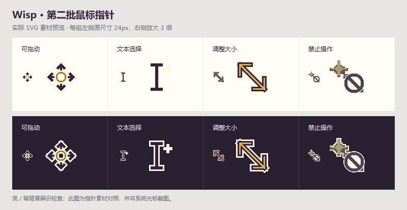

# WP-05 第二批常用指针验证

日期：2026-10-18。用户确认“做吧”后实施四项；技术验证完成，观感待用户审阅。具体确认见父目录 DESIGN.md 第 4.6 节。

## 实现与范围

| 状态 | 原生 SVG | 热点 | 系统回退 |
| --- | --- | --- | --- |
| 可拖动 | wand-grab.svg，四向牵引标记 | (12,12) | grab |
| 文本选择 | wand-text.svg，清晰 I 形和小星 | (12,12) | text |
| 调整大小 | wand-resize.svg，双向斜箭头 | (12,12) | nwse-resize |
| 禁止操作 | wand-forbidden.svg，暗魔杖和圈斜杠 | (5,1) | not-allowed |

均为 24×24，保留紫金和浅色轮廓。产品变更仅 `apps/web/src/features/companion/wand-cursor.css` 与 `apps/web/public/assets/wisp/` 下这四份资源。没有增加业务状态或依赖。

标题栏按钮继续使用可点击反馈；实际拖动仍使用 WP-04 的 grabbing／牵引环，缩放捕获期间跨区域保持新箭头。原生 disabled 及其子树、ARIA 禁用子树优先于普通编辑和悬停；已捕获手势保持最高优先，结束由既有生命周期清理。静态资源在减少动态、隐藏角色时仍可用；select 等非文本原生控件保留合适指针。

## 本轮结果

- TypeScript `tsc --noEmit` 通过。
- 完整专项浏览器回归 **31/31 通过（41.0s）**，此前 29 项基础上增加 2 项语义交互测试，并更新预期变化的精确光标断言。
- 原有窗口用例验证标题栏按钮 hover 优先、真实缩放尺寸变化、跨区域捕获与松开恢复。
- 新文本用例实际鼠标拖选，验证 Ctrl+C 原生 copy 事件未被取消，再输入替换选区；未读取系统剪贴板或做跨软件复制验收。
- 禁用用例验证 ARIA 祖先下按钮／文本子元素显示禁止，不产生有效点击光效；原生禁用按钮不重复提交。
- 独立只读复核发现 `:disabled` 父元素的重要声明不能压过子元素自身 cursor 后，补入 `:disabled *`，并增加真实 disabled 按钮内部带 resize-handle 子元素的断言；最终针对性 **1/1 通过（3.0s）**。未无故重复完整套件。
- 最终 Vite 生产构建通过（88 modules），已更新 dist 和 http://127.0.0.1:15291/ 静态预览。构建使用 configFile:false、envFile:false。
- 独立生产页检查标题栏、正文、缩放点、熔炉真实禁用按钮的四种计算样式、资源及热点正确，无页面 JavaScript 错误。
- 四份 SVG XML／尺寸及浏览器解码检查通过；原尺寸／3 倍、亮暗背景素材对照已查看。独立只读复核通过。
- 专项使用独立 15290 前端，API 全部拦截模拟；未读取环境凭据、调用真实模型或安装依赖。历史 magic-ring.png 截图测试后恢复原字节。
- 上轮 76 项业务单元测试保留历史，本轮未重跑；本记录不代表用户视觉认可或 OS 级光标验收。

## 素材对照

每组左侧 24px、右侧 3 倍放大，按亮／暗背景显示。该图渲染实际资源；浏览器自动截图不捕获原生系统光标，因此不将它描述为产品页面中的光标截图。

## 体验入口

刷新 15291 预览，依次悬停文档标题栏、正文和右下缩放点。点击灵感熔炉并选择“新建材料”后，其他不可用入口显示禁止指针。标题栏最小化按钮仍可点击；拖选、输入与窗口缩放按原有方式操作。

已完成的是本批四项；完成／失败／取消反馈、角色任务动作及依赖后续导入／白板功能的状态继续待讨论。
