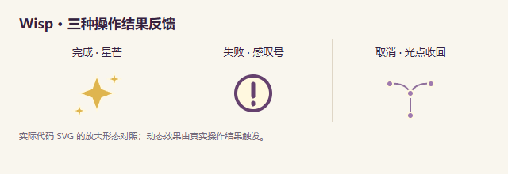

# WP-06 完成／失败／取消反馈验证

日期：2026-10-18。用户确认三种真实结果表达后实施；技术验证完成，用户观感待审阅。具体范围见父目录 DESIGN.md 第 4.7 节。

## 行为

| 结果 | 触发条件 | 形态 |
| --- | --- | --- |
| 完成 | 真正处理及保存成功、剪贴板写入成功、委托提交成功等 | 金色星芒短暂绽开 |
| 失败 | 操作或结果保存失败，保留原有文字 | 紫色圈内感叹号 |
| 取消 | 明确取消未完成准备／新增，或无模型结果时真正停止请求 | 光点向中心收回 |

反馈固定在发起位置附近、边缘内移，约 720ms 后清理，不移动点击热点、不拦截操作。减少动态改为同形静态提示，隐藏魔女仍可显示。普通结果关闭不表示取消；后台任务完成、初始化、自动保存及组件卸载不发指针结果。

来源保护包括最新操作序号、原始控件与面板连接状态、页面可见性、上层模态界面；旧 Promise 不能覆盖新反馈或复制状态文字。熔炉成员变化用稳定的当前面板作为来源，以兼顾按钮正常移除与面板卸载。

Gemini 以真实结局分类：请求已中止且没有模型结果时为取消；已有结果后保存失败仍为失败；停止恰逢保存但最终成功时显示成功。没有改变保存和 abort 的业务机制。

## 验证结果

- TypeScript `tsc --noEmit` 通过；最终 Vite 生产构建通过（91 modules），dist 及 http://127.0.0.1:15291/ 预览已更新，构建禁用环境文件和原 API 代理。
- 首轮完整专项 **38 项：37 通过、1 项测试路径超时**。原有 31 项全部通过；超时来自测试在能力 draft 存在时点击本来禁用的“魔法书”，不是产品反馈失败。
- 将该用例改为真实的“待复制→关闭结果→打开魔法书→旧复制返回静默”，并加旧 reject 不覆盖新成功文字断言后，**新增 7 项最终全部通过（8.1s）**，仅重跑受影响新文件，未重复旧 31 项。
- 新回归覆盖：延迟等待无成功、模型已返回但落盘失败为 error、重试仅保存后 success 且不重复请求；请求失败／实际停止及迟到结果；剪贴板 pending／resolve／reject；复制竞态与来源卸载；熔炉取消新增／保存／真实移出；应用与系统减少动态、隐藏魔女。
- 独立生产页用真实 IndexedDB 事件门控补验 **2/2**：实际保存已完成但完成通知暂挂时点击停止，恢复后仍 success；真实事务已中止但错误通知暂挂时点击停止，恢复后为 error。没有用网络延迟冒充保存阶段。
- 独立生产页完成本地 Understand、模拟剪贴板失败、取消准备，三张实际结果截图已查看；页面无 JavaScript 错误。组件形态对照也已查看。
- 独立只读复核通过，重点关闭保存错误误判取消、旧复制文案竞态和熔炉按钮移除吞提示三项边界。
- 专项使用独立 15290 前端和模拟 API，剪贴板使用测试 Promise；未读取环境凭据、调用真实模型、安装依赖或修改业务协议。magic-ring.png 历史截图已恢复原字节。
- 上轮 76 项业务单元测试保留历史，本轮未重跑。浏览器验证不代表真实模型质量、跨软件复制或 OS 级指针覆盖。

## 视觉证据

该对照放大实际组件 SVG，不是产品界面截图。以下为真实生产页面操作截图，动画暂停于 180ms 便于核对形态，不作性能测量：

- [本地处理完成](screenshots/wp06-success.png)
- [模拟复制失败](screenshots/wp06-error.png)
- [准备取消](screenshots/wp06-cancel.png)

## 文件与入口

- `features/companion/outcome.ts`、`WandOutcome.tsx`、`wand-outcome.css`，由既有 `WandFeedback.tsx` 挂载。
- 七个接线组件：`CheckPanel`、`GeminiPanel`、`GeminiResult`、`GeminiTextResult`、`JointPanel`、`SummonPanel`、`Cauldron`。
- 新 `e2e/wand-outcome.spec.ts` 及专项配置匹配。

刷新 15291，运行任一现有本地能力可观察完成反馈；取消材料确认可观察收回；复制允许后才显示成功，被拒绝时显示失败与原有文字。静态预览的模型路径没有后端，模型相关结果已由模拟验证。
